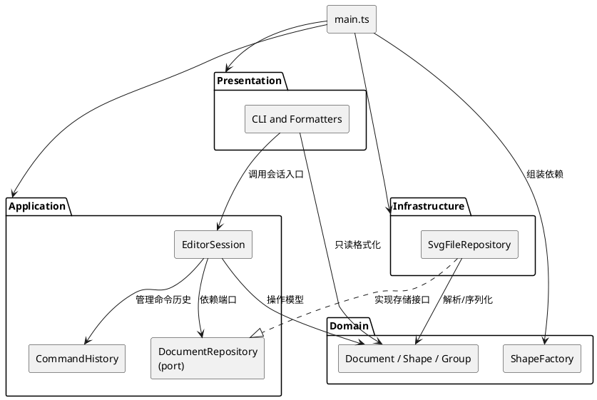

# PROJECT SVG Editor — Phase 1 CLI Editor

## 1. 当前阶段与运行方式

Phase 1 已完成六种内置图形、全部规定 CLI 命令、Command/Composite、SVG I/O、原子性约束及测试验证。

使用 Node.js 24.x 和 npm。开发命令：

| 命令 | 用途 |
| --- | --- |
| `npm run build` | 严格检查生产源码并输出到 dist/ |
| `npm run typecheck` | 检查源码、测试和 Vitest 配置，不输出文件 |
| `npm test` | 自动先类型检查、构建，再执行 Vitest 测试 |
| `npm run test:watch` | Vitest 监听模式；当前入口测试读取构建产物，修改入口后需先重新 build |
| `npm run cli` | 自动构建后进入 REPL；终端使用 `svg> ` 提示符，输入 EOF 结束；支持管道脚本 |

## 2. 架构方案

### 模块划分与职责

| 模块 | 职责 | 包含的类或接口 |
| --- | --- | --- |
| presentation/cli | 交互循环、参数解析、命令分发、输出 | REPL、CommandParser、CommandDispatcher |
| presentation/formatters | 将只读模型信息格式化为文本 | TreeFormatter、ShapeFormatter |
| application | 会话入口与操作协调、撤销重做 | EditorSession、CommandHistory |
| application/commands | 一次编辑操作与恢复信息 | EditCommand、各具体编辑命令 |
| application/ports | 声明应用需要的外部能力 | DocumentRepository |
| domain | 唯一当前文档树、ID 与结构约束、图形工厂 | Document、ShapeCollection、ShapeFactory |
| domain | 图形行为、几何数据封装、树结构与类型工厂 | Shape、Document、ShapeCollection、Rectangle、Circle、Ellipse、Line、TextShape、Group、ShapeFactory |
| infrastructure | SVG XML 解析、序列化、文件读写 | SvgParser、SvgSerializer、SvgFileRepository |
| main.ts | 创建具体对象、注入依赖、启动应用 | 本轮仅为可运行入口 |

实际实现使用 `Document` 作为领域文档名称，并未引入 DOM 类型。`Command` 明确可撤销编辑接口，`EditorSession` 封装会话状态，`DocumentRepository` 是 Application port，`SvgFileRepository` 是 Infrastructure 实现。没有增加仅做转发的 EditorService。

目录结构为：

```text
src/
  presentation/
    cli/
    formatters/
  application/
    commands/
    ports/
  domain/
  infrastructure/
  main.ts
tests/
  domain/
  application/
  presentation/
  integration/
  fixtures/
examples/
doc/
  README.md
```
tests/unit 按职责组织单元测试，integration 验证跨模块或进程行为，fixtures 存测试输入，examples 存后续可回放示例。

### 依赖方向（PlantUML 包图）



1. Domain 不依赖其他层，不读取文件或输出终端，保证图形规则可独立测试。
2. Application 依赖 Domain；外部能力通过本层 ports 接口获得，不导入 Infrastructure 具体实现。
3. Presentation 依赖 Application；格式化可读取 Domain，只能由应用入口发起变更，不直接调用基础设施。
4. Infrastructure 依赖 Domain 与 Application 的 ports，不依赖 Presentation，不管理命令历史。
5. main.ts 是组装入口，可以依赖各层，但不承载编辑算法。

### Command 设计模式选择

将一次编辑封装成具体 `Command`，保存撤销所需旧值、父节点、位置或树变更信息。`CommandHistory` 统一管理 execute/undo/redo 顺序；`EditorSession` 协调当前文档、文件路径与历史。命令组织操作，几何计算仍由图形负责。

实际行为是一条成功编辑命令一个撤销单元；失败命令不改变模型或历史，undo 后的新编辑清空 redo。显示操作不入栈；成功的 init/read/save/canvas 修改设置 I/O 屏障，直到下一次成功编辑才解除。创建、属性、移动、缩放使用对象状态恢复；删除、分组、解组、收编及层级排序使用 `TreeChange` 保存原节点引用和前后子节点序列。

### Composite 设计模式选择

Shape 定义图形统一行为，叶子图形实现自身几何变化，Group 持有有序子节点并递归执行容器操作。Document 和 ShapeCollection 维护全局 ID、单父节点、无环和有序树约束，避免每条命令分别维护节点归属规则。

### 分派位置与待重构点

按名字分派集中在 CommandDispatcher（命令名到处理入口）与 ShapeFactory（类型名到具体图形）两处，并作为未来插件化/注册机制的变化点记录。SvgParser 通过 ShapeFactory 的参数 schema 读取 SVG，SvgSerializer 和 Formatter 通过 ShapeVisitor 消费多态接口；这些层不复制 `switch(type/tag)`。

### 初步变化点假设

| 可能变化 | 当前理由 |
| --- | --- |
| 新编辑命令 | 命令与历史管理分离，后续增加命令不应改变历史栈机制 |
| 新图形类型 | 统一图形行为与集中工厂；暂不实现插件注册和加载 |
| 交互形式与显示格式 | CLI 与格式化分开，应用入口不解析原始文本；本阶段暂无 GUI |
| 文件格式与存储方式 | 通过 DocumentRepository 隔离存储，但不宣称模型支持任意格式 |
| 撤销性能与记录策略 | 恢复数据归命令，先按具体用例验证，不提前构建快照框架 |
| 大文档与多文档 | 当前只有一棵文档树，不增加缓存同步或多文档管理 |

## 3.协作过程记录

- 我对AI要求分阶段开发，并强调 Lab1 的 Command设计模式、分层架构与 review方案。开发时保留必要 Composite 设计模式，不提前实现后续插件框架。
- 与Codex讨论比较了 cli 平铺与 presentation/cli、formatters 分组，最终选后者；确认 SvgDocument、EditCommand 命名与 EditorSession 应用入口，暂不增加 EditorService。
- 本轮仅初始化工具链、目录和架构文档。工程验证采用真实 Node 子进程启动编译产物，检查 ESM 构建结果能运行并正常退出，不伪造 SVG 业务测试。

## 4. 一致性自查

- **模块划分** 实际目录为 `presentation/`、`application/`、`domain/`、`infrastructure/` 四层，且 `main.ts` 仅负责组装 `EditorSession`、`CommandDispatcher`、`REPL` 和 `SvgFileRepository`。早期记录中的 `domain/shapes/`、`SvgDocument`、`SvgRepository` 是方案阶段名称，已在本文件中按实际类名修订。
- **依赖方向。** Domain 仅依赖 Domain；Application 依赖 Domain 和 `application/ports`；Presentation 依赖 Application、Domain 的只读模型和自身 formatter；Infrastructure 依赖 Application port 与 Domain；具体 Infrastructure 未被 Application 直接导入。`src/main.ts` 是唯一组装入口。

## 5. 功能完整性与质量保障

每个新增 feature 都补充了对应的单元测试，并在需要时增加真实 CLI 集成测试。测试重点如下：

- **六种图形与 create**：参数校验、几何边界、样式、文本引号、嵌套创建和错误原子性。
- **move / scale / set**：叶子与 Group 的递归行为、属性白名单、溢出失败恢复和撤销重做。
- **group / ungroup / addto**：父子关系、顺序、循环检测、节点身份及单步撤销。
- **delete / front / back**：整棵子树删除恢复、z-order、原位置恢复和 redo 行为。
- **read / save / canvas**：SVG round-trip、自动补 ID、警告、文件错误、尺寸校验和 I/O 后 undo/redo 限制。
- **tree / show / help 与 REPL**：输出格式、命令语法、引号、错误前缀和真实进程会话。

测试同时覆盖 ID 唯一性、单树结构、失败不改变模型或历史，以及 Command/Composite 的核心约束。

在最终代码状态执行：

```text
npm.cmd test
```

该命令按 `package.json` 先执行 `typecheck` 和 `build`，再运行 Vitest。最终结果：

```text
TypeScript typecheck: passed
Production build: passed
Test Files: 14 passed (14)
Tests: 156 passed (156)
```
